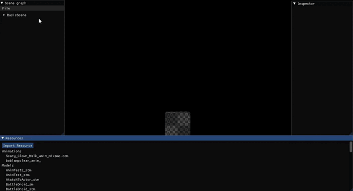
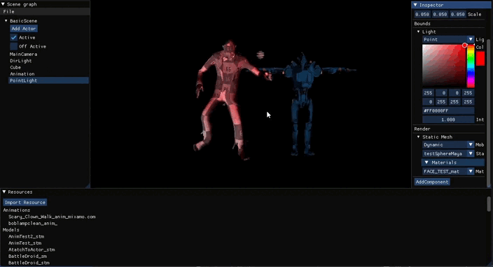
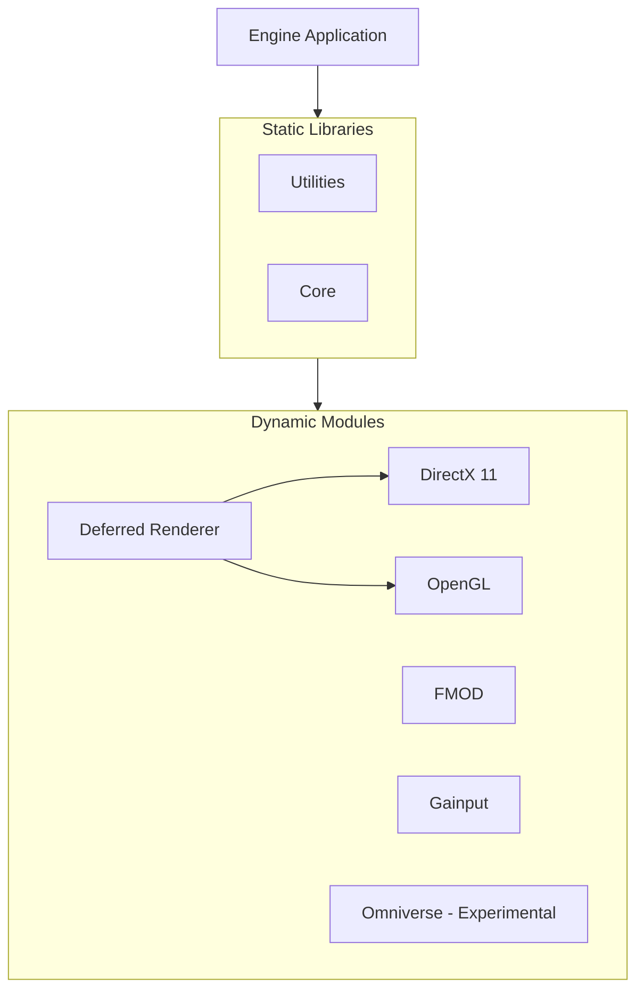
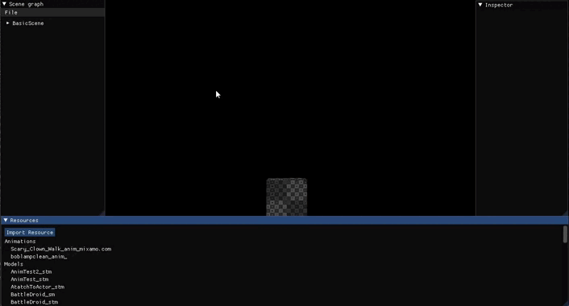

# EchoEngine

EchoEngine is a modular C++ game engine originally developed as a university project during my Video Game Development Engineering studies.

The engine features interchangeable DirectX 11 and OpenGL rendering backends, deferred rendering, skeletal animation with GPU-based mesh skinning, an actor-component architecture, hierarchical scene management, modular audio and input systems, and an interactive development interface built with Dear ImGui.

## Engine Architecture

EchoEngine uses a modular architecture based on dynamic linking. Utilities and Core are the only statically linked modules, while the remaining modules are dynamically loaded through DLL files.

Macro-based configuration allows the selection of which modules the engine initializes, providing flexibility in its configuration and underlying API implementations.

## Project Status

The original engine has been successfully compiled and tested on my current Windows development environment. However, some third-party dependencies are outdated, and some of the original project assets are no longer available.

I am currently developing a successor called NyxaEngine, focused on updated dependencies, improved modular architecture, and broader operating system compatibility.

## Technical

### Development Interface

The main engine executable integrates Dear ImGui to provide a development interface for interacting with engine resources, actors, and scenes in real time.

- Actor creation, deletion, and selection.
- Actor transformation and property editing.
- Scene loading and scene management.
- Interaction with the engine's hierarchical scene structure.
- Material, texture, and resource configuration.
- Real-time visualization of changes within the rendered scene.

*Actor creation and scene interaction through the development interface. Click the GIF to watch the full video.*

### Skeletal Animation and GPU Skinning

The engine implements a skeletal animation system that evaluates animations on the CPU and performs mesh deformation on the GPU through vertex shaders.

- Importing mesh geometry, skeletal hierarchies, bone indices, and per-vertex bone weights.
- Construction of hierarchical bone structures.
- Importing and storing animation keyframe data.
- Runtime keyframe interpolation and evaluation of bone transformations.
- Submission of animation and skeletal data to the graphics pipeline.
- GPU-based mesh skinning through vertex shaders, deforming vertices according to their associated bone transformations and influence weights.

*Real-time skeletal animation, deferred rendering, and lighting demonstration. Click the GIF to watch the full video.*

## Engine Modules

### Utilities

Provides foundational types, mathematical operations, and general-purpose functionality shared across the engine.

- Type aliases and redefinitions for standardization across engine modules.
- Wrapper headers for standard library types, with optional Boost types when Boost is selected as the preferred library.
- Platform math operations using the standard library.
- Mathematical types:
  - 2D, 3D, and 4D vectors.
  - 2×2, 3×3, and 4×4 matrices.
  - Quaternions.
- Geometric primitives and bounding volumes, including quads, triangles, axis-aligned bounding boxes (AABBs), spheres, capsules, planes, and frustums.
- Foundational engine types, including camera states and transforms.
- Dynamic library loading and exported function resolution.
- File reading and writing utilities.
- Logging functionality with console and file output.
- Smart pointer management utilities for object creation and safe resource release.
- Time management and delta time tracking.
- The `Module` class, developed by Samuel Prince, one of my university professors. It follows a singleton-like pattern with controlled initialization and support for initialization through derived classes. This class serves as a foundation for the engine's modular architecture.

### Core

Serves as the central framework connecting the engine's modules and managing its resources and scene structure.

- Macro-based configuration for selecting and initializing engine modules.
- Base interfaces for each module type, allowing derived implementations to be initialized through dynamically loaded libraries.
- Engine resource definitions for animations, meshes, textures, materials, skeletons, and other resources.
- Hierarchical scene graph management using a tree structure.
- Support for multiple active and inactive scenes, including primary and secondary scenes.
- Actor-component architecture supporting active and inactive actors within each scene.

*Scene loading and management. Click the GIF to watch the full video.*

### DirectX 11 Graphics API

A graphics backend implementing the rendering functionality required to display scenes using DirectX 11.

- Graphics API initialization and rendering operations.
- Shader compilation and management.
- Geometry and material data submission to shaders.
- Window creation and rendering output.
- Support for four shader stages:
  - Vertex shaders.
  - Pixel shaders.
  - Hull shaders.
  - Domain shaders.

### OpenGL Graphics API

An alternative graphics backend implementing rendering functionality using OpenGL.

- Graphics API initialization and rendering operations.
- Shader compilation and management.
- Geometry and material data submission to shaders.
- Window creation and rendering output.
- Support for two shader stages:
  - Vertex shaders.
  - Fragment shaders.

### Deferred Renderer

Implements the engine's deferred rendering pipeline independently of the underlying graphics API.

- Decouples the rendering pipeline from the graphics API, allowing the same pipeline to operate with either the DirectX 11 or OpenGL backend.
- Renders scene geometry into a geometry buffer (G-buffer), storing position, normal, and color information in separate textures.
- Performs lighting calculations using the information stored in the G-buffer.
- Applies post-processing effects to the rendered output.

### FMOD Audio API

Provides audio playback functionality through the FMOD API.

- Loading and playback of sound effects and music.
- Support for audio resources with different channel configurations.
- Simultaneous playback of multiple sounds.

### Gainput Input API

Provides keyboard and mouse input management through the Gainput API.

- Keyboard and mouse input capture.
- Frame-based input state tracking.
- Detection of three input states:
  - Pressed during the current frame.
  - Currently held down.
  - Released during the current frame.

### Omniverse API (Experimental)

An experimental integration with the NVIDIA Omniverse API, intended to support scene interoperability between different working environments.

- Scene reading and writing through the Omniverse API.
- Communication with an Omniverse application running on the same computer.
- This was the final module developed for the original project and remains partially implemented.
